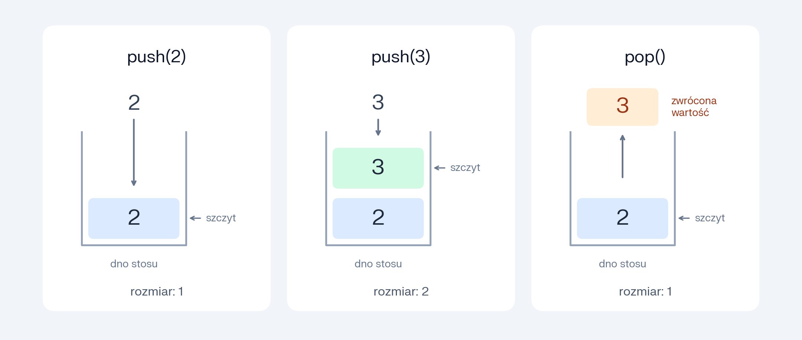

# C-Lab4


Czwarte laboratorium z języka C, przygotowane do pracy w środowisku GitHub Codespaces.

## Cel laboratorium

Celem zajęć jest zapoznanie studenta z:

- przechowywaniem danych w tablicy,
- rozróżnieniem pojemności tablicy i liczby zapisanych elementów,
- organizacją danych w postaci stosu,
- implementacją operacji `push` i `pop`,
- obliczaniem wyrażeń w odwrotnej notacji polskiej,
- dynamicznym przydzielaniem i zwalnianiem pamięci,
- powiększaniem pamięci przez `realloc`.

## Struktura projektu

```text
.
├── .devcontainer/
│   └── devcontainer.json
├── .vscode/
│   ├── launch.json
│   └── tasks.json
├── src/
│   ├── zad01.c
│   ├── zad02.c
│   ├── zad03.c
│   ├── zad04.c
│   ├── zad05.c
│   └── zad06.c
├── tests/
├── build/
├── run_tests.sh
├── Makefile
└── README.md
```

Najważniejsze elementy projektu:

- `src/zadXX.c` — plik źródłowy danego zadania,
- `build/zadXX` — plik wykonywalny danego zadania,
- `run_tests.sh` — skrypt sprawdzający wynik programu.

Każdy plik `src/zadXX.c` jest osobnym programem z własną funkcją `main`.

## Budowanie, uruchamianie i testowanie

Przykład dla zadania 1:

```bash
make TASK=zad01
make run TASK=zad01
make test TASK=zad01
```

Aby zbudować wszystkie zadania:

```bash
make all
```

Możesz również skorzystać z tasków w VS Code:

- `build` — budowanie wybranego zadania,
- `run` — uruchomienie wybranego zadania,
- `test` — sprawdzenie wybranego zadania,
- `build-all` — budowanie wszystkich zadań.

Taski `build`, `run` i `test` wyświetlają listę zadań do wyboru.

Kod przygotuj w standardzie C99. Kompilacja wykorzystuje flagi:

```text
-std=c99 -Wall -Wextra -Wpedantic -g
```
## Stos

Stos działa zgodnie z zasadą LIFO: ostatni dodany element jest pobierany jako pierwszy.

Podstawowe operacje:

| Operacja | Znaczenie |
|---|---|
| `push` | Dodanie wartości na szczyt stosu |
| `pop` | Pobranie i usunięcie wartości ze szczytu stosu |

Przykład:




## Funkcje wykorzystywane w laboratorium

### `malloc`

Nagłówek: `<stdlib.h>`.

Przydziela blok pamięci o podanej liczbie bajtów. Zwraca wskaźnik do przydzielonego obszaru albo `NULL`, jeżeli operacja się nie powiodła.

Przydzielona pamięć nie jest automatycznie wyzerowana.

### `realloc`

Nagłówek: `<stdlib.h>`.

Zmienia rozmiar wcześniej przydzielonego bloku pamięci. Może przenieść dane w inne miejsce.

Wynik zapisuj najpierw do wskaźnika pomocniczego.

Jeżeli operacja się powiedzie, korzystaj ze zwróconego wskaźnika. Jeżeli się nie powiedzie, zwraca `NULL`, a poprzedni blok pozostaje dostępny.

W zadaniach nie wywołuj `realloc` z rozmiarem równym zero.

### `free`

Nagłówek: `<stdlib.h>`.

Zwalnia pamięć przydzieloną dynamicznie. Po zwolnieniu nie korzystaj z danych w tym obszarze.

## Zadania

### 1. Wypełnianie tablicy z klawiatury

Plik: `src/zad01.c`.

Program startowy zapisuje w tablicy jedną liczbę i wypisuje jej zawartość.

Zmodyfikuj go tak, aby użytkownik mógł wprowadzić cztery liczby typu `float`.

1. Zachowaj tablicę `data` o pojemności czterech elementów oraz licznik `size`.
2. Zastąp przypisanie wartości wpisanej w kodzie odczytem z klawiatury.
3. Każdą liczbę odczytuj z osobnej linii przez `fgets` i konwertuj przez `strtof`.
4. Zapisuj liczbę pod indeksem `size`, a następnie zwiększaj `size`.
5. Po każdym dopisaniu wypisz liczbę elementów, pojemność i zawartość tablicy.
6. Powtarzaj odczyt, dopóki jest wolne miejsce.
7. Po zapisaniu czwartej liczby wypisz `array full` i zakończ program. Nie odczytuj piątej liczby.

Wartości wypisuj przez `%.4f`, a `size` i pojemność przez `%zu`. Nie dodawaj spacji na końcach wierszy ani zaproszeń do wpisania danych.

#### Sprawdzenie

```bash
make test TASK=zad01 lub Run Task: Test i wybór zad01
```

### 2. Stos na tablicy

Plik: `src/zad02.c`.

Skopiuj rozwiązanie zadania 1. Dodając funkcję `pop`, `push` i `is_empty` zasymuluj dzialnie stosu za pomocą tablicy.

Tablicę `data[4]` i licznik `size` zadeklaruj poza `main`, jako zmienne globalne.

Dodaj funkcje:

| Funkcja | Zadanie |
|---|---|
| `int push(float value)` | Dodaje liczbę; zwraca `1` po dodaniu albo `0`, gdy stos jest pełny |
| `float pop(void)` | Usuwa ostatnią liczbę i zwraca jej wartość |
| `int is_empty(void)` | Zwraca `1` dla pustego stosu albo `0` dla niepustego |

Funkcje stosu nie wypisują komunikatów. Nie wywołuj `pop`, gdy stos jest pusty.

#### Przebieg programu

1. Odczytaj cztery liczby, każdą z osobnej linii.
2. Każdą dodaj przez `push`.
3. Po dodaniu wypisz dodaną wartość i stan stosu.
4. Spróbuj dodać przez `push` jeszcze `99.0f`, wpisane bezpośrednio w kodzie.
5. Jeśli stos jest pełny, wypisz `stack full`. Nie zmieniaj danych ani `size`.
6. Pobieraj liczby przez `pop`, dopóki stos nie jest pusty.
7. Po każdym pobraniu wypisz zwróconą wartość i pozostałą zawartość stosu.
8. Po opróżnieniu wypisz `stack empty`.

### 3. Jedno działanie w odwrotnej notacji polskiej

Plik: `src/zad03.c`.

Program startowy odczytuje dwie liczby i operator, a następnie wykonuje działanie przez funkcje `add`, `subtract`, `multiply` i `divide`.

Zmodyfikuj go tak, aby argumenty i wynik działania były przechowywane na stosie.

#### Wymagane zmiany

1. Przenieś z zadania 2 globalną tablicę stosu, licznik `size` oraz funkcje `push`, `pop` i `is_empty`.
2. Zachowaj odczyt przez `fgets`, konwersję przez `strtof`, funkcje arytmetyczne i wybór działania przez `switch`.
3. Pierwszą odczytaną liczbę odłóż na stos przez `push`.
4. Drugą odczytaną liczbę również odłóż przez `push`.
5. Pobierz argumenty działania:
   - pierwszy `pop` zwraca prawy argument — przypisz go do `b`;
   - drugi `pop` zwraca lewy argument — przypisz go do `a`.
6. Wykonaj działanie `a + b`, `a - b`, `a * b` albo `a / b`.
7. Odłóż wynik na stos przez `push`.
8. Wypisz wynik, przekazując do `printf` bezpośrednio wartość zwróconą przez `pop`.

Nie wypisuj wyniku bezpośrednio ze zmiennej przechowującej rezultat działania. Po wypisaniu wyniku stos ma być pusty.

Zwróć uwagę na **kolejność** argumentów przy odejmowaniu i dzieleniu. Dla `15.5 4.25 -` program ma obliczyć `15.5 - 4.25`.

#### Przebieg programu

1. Odczytaj linię z klawiatury.
2. Jeżeli użytkownik wpisał samo `q`, zakończ program.
3. W przeciwnym razie odczytaj dwie liczby i operator.
4. Oblicz i wypisz wynik z wykorzystaniem stosu.
5. Wróć do odczytu kolejnej linii.

Jedno działanie wpisuj w jednej linii. Liczby i operator oddzielaj pojedynczymi spacjami.

Obsługuj operatory `+`, `-`, `*` i `/`. Na tym etapie zakładamy poprawny zapis danych i niezerowy dzielnik.

#### Przykład użycia

Wpisz z klawiatury:

```text
15.5 4.25 -
q
```

Program wypisuje:

```text
result: 11.2500
```

Wynik wypisuj przez `%.4f`, a wiersz zakończ znakiem `\n`. Nie wypisuj zaproszeń, zawartości stosu ani dodatkowych pustych linii. Dla `q` niczego nie wypisuj.

### 4. Wieloetapowe wyrażenia w odwrotnej notacji polskiej

Plik: `src/zad04.c`.

Skopiuj rozwiązanie zadania 3. Rozszerz kalkulator tak, aby jedna linia mogła zawierać kilka działań.

Dla wyrażenia `2 3 + 4 *` program ma najpierw obliczyć `2 + 3`, a następnie pomnożyć otrzymany wynik przez `4`.

#### Przetwarzanie wyrażenia

Przetwarzaj kolejne elementy linii od lewej do prawej.

1. Jeżeli element jest liczbą, przekonwertuj go przez `strtof` i odłóż na stos przez `push`.
2. Jeżeli element jest operatorem:
   - sprawdź, czy na stosie są co najmniej dwie liczby;
   - pobierz prawy argument do `b`;
   - pobierz lewy argument do `a`;
   - wykonaj działanie wybrane przez `switch`;
   - odłóż wynik na stos przez `push`.
3. Po przetworzeniu całej linii sprawdź, czy na stosie została dokładnie jedna liczba.
4. Wypisz wynik, przekazując do `printf` bezpośrednio wartość zwróconą przez `pop`.

Wykorzystaj wskaźnik końca konwersji zwracany przez `strtof`, aby ustalać, gdzie kończy się liczba.

Operator rozpoznawaj jako osobny, jednoznakowy element. Znak `-` może również rozpoczynać liczbę ujemną.

Zachowaj funkcje arytmetyczne z poprzedniego zadania.

#### Obsługa błędów

| Sytuacja | Komunikat |
|---|---|
| Operator napotkany przy mniej niż dwóch liczbach na stosie | `error: stack underflow` |
| Po przetworzeniu wyrażenia na stosie nie została dokładnie jedna liczba | `error: invalid input` |

Po wykryciu błędu:

1. Przerwij przetwarzanie bieżącej linii.
2. Wypisz jeden komunikat zamiast wyniku.
3. Wyzeruj `size`.
4. Przejdź do odczytu następnej linii.

Nie wywołuj `pop`, jeżeli brakuje argumentów.

Przed rozpoczęciem każdego wyrażenia stos ma być pusty. Zachowaj kończenie programu przez wpisanie `q`.

Na tym etapie zakładamy poprawny zapis liczb i operatorów, niezerowy dzielnik oraz wyrażenia mieszczące się na stosie o pojemności czterech liczb.

#### Przykład użycia

Wpisz z klawiatury:

```text
2 3 + 4 *
1 +
q
```

Program wypisuje:

```text
result: 20.0000
error: stack underflow
```

Każde wyrażenie zatwierdzaj klawiszem Enter. Elementy oddzielaj pojedynczymi spacjami, bez spacji na początku i końcu linii.

Wynik wypisuj przez `%.4f`. Każdy wiersz zakończ znakiem `\n`. Nie wypisuj zaproszeń, zawartości stosu ani dodatkowych pustych linii. Dla `q` niczego nie wypisuj.

### 5. Stos z dynamicznie przydzielaną pamięcią

Plik: `src/zad05.c`.

Program startowy zawiera stos oparty na tablicy czterech liczb jak w zadaniu 2. Odczytuje liczby z klawiatury i dodaje je na stos. Po wpisaniu `q` zdejmuje wszystkie elementy i kończy działanie.

Zmodyfikuj program tak, aby pamięć stosu była przydzielana przez `malloc`, powiększana przez `realloc` i zwalniana przez `free`.

#### Przydzielenie pamięci

1. Zastąp globalną tablicę globalnym wskaźnikiem `data` do danych typu `float`.
2. Zachowaj globalny licznik `size` i dodaj zmienną `capacity` przechowującą pojemność.
3. Ustaw początkową pojemność na `2`, a liczbę elementów na `0`.
4. Przed rozpoczęciem odczytu przydziel przez `malloc` miejsce na dwie liczby.
5. Liczbę bajtów oblicz z użyciem `sizeof`.
6. Sprawdź, czy przydzielenie pamięci się powiodło.

Zachowaj funkcje `push`, `pop` i `is_empty`.

#### Powiększanie stosu

Zmień funkcję `push`. Gdy `size == capacity`:

1. Oblicz nową pojemność, dwukrotnie większą od dotychczasowej.
2. Wywołaj `realloc`, aby powiększyć pamięć.
3. Wynik zapisz najpierw do wskaźnika pomocniczego.
4. Jeżeli operacja się powiedzie, zaktualizuj `data` i `capacity`.
5. Dopisz liczbę i zwiększ `size`.

Po poprawnym dodaniu liczby `push` zwraca `1`.

Jeżeli powiększenie pamięci się nie powiedzie, `push` zwraca `0`. Dotychczasowy wskaźnik, pojemność, liczba elementów i zapisane dane mają pozostać bez zmian.

Pojemność ma rosnąć kolejno: `2`, `4`, `8`, `16` i tak dalej. Nie zmniejszaj jej przy zdejmowaniu elementów.

Usuń komunikat `stack full`. Brak miejsca ma teraz powodować powiększenie pamięci.

#### Zwalnianie pamięci

Po zdjęciu wszystkich elementów wypisz `stack empty`, zwolnij pamięć przez `free` i zakończ program.

Jeżeli `malloc` lub `realloc` nie przydzieli pamięci:

1. Wypisz `error: memory allocation failure`.
2. Zwolnij wcześniej przydzieloną pamięć, jeżeli taka istnieje.
3. Zakończ program kodem `1`.

Funkcje stosu nie wypisują komunikatów. Niepowodzenie `push` obsłuż w `main`.

#### Przykład użycia

Wpisuj liczby z klawiatury, każdą w osobnej linii. Wpisanie `q` kończy dodawanie i rozpoczyna zdejmowanie wszystkich elementów.

```text
2
3
q
```

Program wypisuje:

```text
push: 2.0000, size: 1, capacity: 2, data: 2.0000
push: 3.0000, size: 2, capacity: 2, data: 2.0000 3.0000
pop: 3.0000, size: 1, capacity: 2, data: 2.0000
pop: 2.0000, size: 0, capacity: 2, data:
stack empty
```

Po każdym dodaniu i pobraniu wypisuj aktualny stan stosu. Przy pobieraniu wypisz wartość zwróconą przez `pop` oraz stan już po jej usunięciu.

Wartości wypisuj przez `%.4f`, a rozmiar i pojemność przez `%zu`.

Elementy wypisuj od dna do szczytu stosu. Przed każdym elementem umieść jedną spację. Dla pustego stosu zakończ wiersz bezpośrednio po `data:`.

Nie dodawaj spacji na końcach wierszy, zaproszeń ani dodatkowych pustych linii. Na tym etapie zakładamy poprawny zapis liczb.

### 6. Kalkulator z dynamicznym stosem

Plik: `src/zad06.c`.

Skopiuj rozwiązanie zadania 4. Zastąp stos oparty na tablicy o stałej pojemności stosem dynamicznym z zadania 5.

#### Wymagane zmiany

1. Zastąp globalną tablicę wskaźnikiem `data`.
2. Zachowaj licznik `size` i dodaj pojemność `capacity`.
3. Ustaw początkową pojemność na `2`.
4. Przed rozpoczęciem pętli programu przydziel pamięć przez `malloc`.
5. Wykorzystaj funkcję `push`, która podwaja pojemność przez `realloc`, gdy brakuje miejsca.
6. Zachowaj funkcje `pop`, `is_empty`, funkcje arytmetyczne i sposób obliczania wyrażeń.
7. Po zakończeniu pracy zwolnij pamięć przez `free`.

Liczby nadal trafiają na stos, operator pobiera dwa argumenty i odkłada wynik, a wynik końcowy wypisujesz przez `pop`.

#### Pamięć między wyrażeniami

Pamięć przydziel raz przed pętlą i wykorzystuj do kolejnych wyrażeń.

Nie zwalniaj jej ani nie zmniejszaj pojemności po każdym obliczeniu. Przed rozpoczęciem nowego wyrażenia stos ma być pusty, ale przydzielone miejsce pozostaje dostępne.

#### Obsługa błędów

Zachowaj komunikaty z zadania 4 `error: stack underflow` oraz `error: invalid input`

Po błędzie wyrażenia wyzeruj `size` i przejdź do odczytu następnej linii.

Jeżeli przydzielenie lub powiększenie pamięci się nie powiedzie, wypisz `error: memory allocation failure`, zwolnij wcześniej przydzieloną pamięć i zakończ program kodem `1`.

Nadal zakładamy poprawny zapis liczb i operatorów oraz niezerowy dzielnik.

#### Przykład użycia

Wpisz z klawiatury:

```text
2 3 4 5 + * +
q
```

Program wypisuje:

```text
result: 29.0000
```

Każde wyrażenie zatwierdzaj klawiszem Enter. Aby zakończyć program, wpisz `q` i naciśnij Enter.

Wynik wypisuj przez `%.4f`, przekazując do `printf` bezpośrednio wartość zwróconą przez `pop`.

Nie wypisuj pojemności, zawartości stosu, komunikatów o powiększaniu pamięci, zaproszeń ani dodatkowych pustych linii. Dla `q` niczego nie wypisuj.

Każdy wiersz zakończ znakiem nowej linii `\n`.